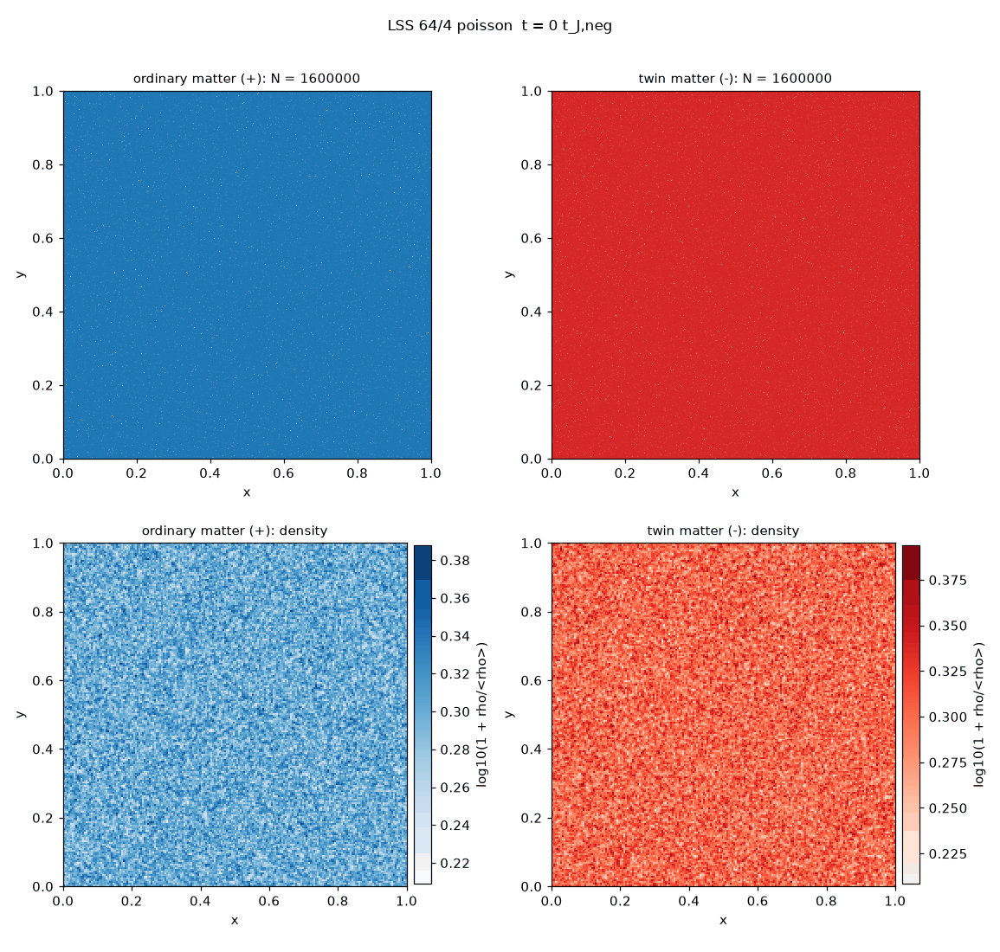

# Twin-matter N-body simulations: a reproduction and stress test

This repository reproduces, and then stress-tests, the 2-D N-body simulations of "twin matter" published by Jean-Pierre Petit and collaborators in the 1990s and early 2000s, in which a population of negative-mass particles interacts gravitationally with ordinary matter. The goal is neutral: find out how far the original results can be reproduced with modern numerical methods, and where they stop holding.

| Static box (original setup) | Expanding box, 8 Jeans lengths | Expanding box, 16 Jeans lengths |
|---|---|---|
|  |  |  |

## Summary of findings

In a static periodic box, the mechanism described in the original work is robust: the heavy negative-mass population collapses into clumps, ordinary matter is pushed out into walls around them, and a cellular pattern appears after about 2 to 3 negative Jeans times. That pattern is transient, however. Across five random seeds, two timesteps and two box sizes, the negative clumps keep merging until a single box-scale clump remains. Under the original assumptions, the simulations support "cells form" but not "cells are stable".

With a kinematic cosmic expansion added (not part of the original setup), merging slows considerably and a multi-cell network with negative clumps inside ordinary-matter voids survives to the end of the run. In a box twice as large, the network has the same characteristic size in Jeans units (about one clump per 16 to 18 square Jeans lengths), so it is not a box-size artefact. It is still not frozen: in both box sizes, about two-thirds of the clumps merge between 5 and 20 Jeans times. Whether coarsening eventually stalls is the main open question.

All results are 2-D. A 3-D extension and a GPU port are planned.

## Background: the claims being tested

In the twin-matter (later "Janus") model, ordinary matter and twin matter of negative mass interact only through gravity, with three interaction laws: like masses attract, and positive and negative masses repel each other. The 2001 conference paper "Twin matter against dark matter" (Petit, Midy and Landsheat) describes 2-D simulations starting from uniform distributions of both populations, with the twin population 64 times denser and with a Jeans time eight times shorter, reporting a cellular large-scale structure with twin-matter clumps surrounded by ordinary matter, and a long-lived barred spiral galaxy confined by surrounding twin matter.

The specific claims tested here are that a cellular pattern forms, that the twin-matter clumps are stable, and that the structure is long-lived. The spiral-galaxy scenario is implemented in the code but has not yet been tested.

## Methodology

### Research pipeline

The project was carried out with a chain of AI-assisted steps, each written to a file in this repository so it can be inspected:

1. **Crawl** (`scriptscrape.py`): the author's website was crawled breadth-first and each page's text saved locally. The scraped content belongs to the site's author and is not included in this repository.
2. **Per-page analysis**: each page was summarized by Claude Haiku.
3. **Synthesis** (`synthesize.py`, output `final_report.md`): Claude Opus merged the summaries into a categorized report of the site.
4. **Investigation** (`investigate.py`, output `astrophysics_investigation.md`): Claude Fable carried out a neutral investigation of the computational astrophysics, focused on the twin-matter N-body simulations.
5. **Simulation design and code** (`build_sim.py`, outputs `simulation_notes.md` and `sim/`): Claude Fable designed the simulation from the investigation and the original pages, listing every assumption where the sources are vague, and wrote it as separate modules.
6. **Runs and validation**: simulations were run, tested and debugged as described below.
7. **Interpretation** (`sim/interpret_run.py`, outputs `interpretation.md` in each run folder): Claude Fable reviewed each key run's snapshots alongside its measured data.

All simulation code was AI-generated and should be read with that in mind. It was validated through the convergence and control tests below rather than line-by-line review.

### Numerical model

- **Method**: particle-mesh (PM) gravity with FFT, in a periodic 2-D box of unit size, using the kernel -2πG/|k| (a razor-thin sheet with a 1/r² force law in the plane). A direct-summation O(N²) mode is available for cross-checks.
- **Interaction laws**: same-sign masses attract; opposite-sign masses repel. Equations of motion use |m| as inertial mass, so the |m|-weighted momentum is conserved while the signed momentum is not.
- **Integrator**: leapfrog kick-drift-kick, fixed timestep (default 0.02 negative Jeans times), float64.
- **Mean density**: the k=0 mode is removed (the standard "Jeans swindle"), since the box has a net negative mass.
- **Initial conditions**: Poisson-uniform positions for both populations, Maxwellian velocities; shot noise seeds the instability.
- **Parameters from the original work**: twin-to-ordinary density ratio 64, velocity dispersion ratio 4.
- **Assumed**: absolute velocity scale set so the negative Jeans length is 1/8 of the box; softening equal to the PM cell size; run length 20 negative Jeans times.
- **Expansion (optional)**: comoving frame with a(t) ∝ t^(2/3) switched on at 1 Jeans time. This is a standard kinematic expansion law, not one derived from the Janus model.

All 17 assumptions (A1 to A17) are printed at the start of every run and saved as `assumptions.txt` in each output folder.

### Diagnostics and pre-registered criteria

Each run records energy and momentum conservation, clump counts and masses, a segregation index (anti-correlation of the two density fields), a persistence index (similarity of the pattern to a reference time), and the dominant structure scale. Three pass/fail criteria were fixed before any results: `cells_form`, `stable_clumps` and `persistence`.

### Validation

The first runs had energy errors of several hundred percent, so no results were trusted until this was resolved:

| Test | Result | Conclusion |
|---|---|---|
| Timestep convergence (static) | Energy error fell only 2× per halving | Not a timestep problem |
| Positives alone | 0.5% error | Force solver and integrator are sound |
| Negatives alone | 134% error | Problem appears with the collapsing population |
| Positives alone, rescaled to match the negatives exactly | Identical energy log, digit for digit | No sign bug in the energy calculation |
| Negatives alone, 5k / 20k / 80k particles | 134% / 40% / 9.7% | Discreteness heating: error ∝ 1/N |
| Mixed, 800k particles, 64² grid | Energy within about ±1% | Trustworthy baseline |
| Baseline with half timestep | All metrics unchanged | Converged in timestep |
| Expansion run with half timestep | All metrics unchanged | Converged in timestep |

The key lesson is that the strongly unstable negative population needs about 200 particles per grid cell to avoid artificial heating. Runs with fewer particles produced misleading verdicts.

In expanding runs, E = KE + U is not conserved by design, so its large reported drift is expected; timestep convergence is used as the accuracy check instead.

## Results

### Static box (original setup)

| Run | Final negative clumps | Segregation | Notes |
|---|---|---|---|
| Baseline, 5 seeds | 1 in every seed | -0.64 to -0.76 | Cells at t ≈ 2-3, merge to one clump by t ≈ 7 |
| Half timestep | 1 | -0.69 | Identical to baseline |
| Box twice as large | 1 | -0.69 | Merging continues to box scale |
| Velocity ratio 1 | 1 | -0.74 | The positives' temperature hardly matters |

Timeline of the baseline run: the first 5 clumps appear at 2 Jeans times, peak at 8 clumps at 2.5, merge steadily to one clump by 5.5, and the final clump (about 40% of the negative mass, a quarter of the box across) is frozen from about 7 Jeans times onward.

### Expanding box

| Run | Final negative clumps | Dominant scale | Clump loss, t = 5 to 20 |
|---|---|---|---|
| 8 Jeans lengths across | 4 | Whole box | -64% |
| 8 Jeans lengths, half timestep | 4 | Whole box | -64% |
| 16 Jeans lengths across | 14 | 1/3 of the box | -69% |

In expanding runs, the twin clumps remain inside ordinary-matter voids throughout and the populations never mix. The decline of the segregation index in these runs appears to be a property of the index once most twin mass is concentrated in a few small clumps, rather than a physical mixing.

### In progress

A seed ensemble with expansion, and a longer big-box expansion run (60 Jeans times) to see whether coarsening stalls.

## Limitations

- 2-D only; the original work was also 2-D, but real structure formation is 3-D.
- The absolute velocity scale, softening and run length are not given in the original sources and were assumed.
- The expansion law is a generic kinematic one, not derived from the Janus model, and expansion was not part of the original simulations.
- Some diagnostics have known weaknesses: persistence depends on the choice of reference time, and the `cells_form` trigger fires on weak early anti-correlation.
- No quantitative comparison with observations has been made.

## Reproducing

Requirements: Python 3.12, numpy, scipy, matplotlib (and anthropic for the AI pipeline scripts, with `ANTHROPIC_API_KEY` set in the environment).

```bash
python -m venv venv && source venv/bin/activate
pip install numpy scipy matplotlib anthropic
cd sim
python main.py --help
python main.py assumptions lss

# Trustworthy static baseline (about 3 minutes)
python main.py lss --grid 64 --npos 400000 --nneg 400000

# Seed ensemble
python main.py ensemble lss --seeds 5 --grid 64 --npos 400000 --nneg 400000

# Expansion, big box (about 12 minutes)
python main.py lss --grid 128 --npos 1600000 --nneg 1600000 --lambda-j-neg 0.0625 --expansion

# Fable's review of a run, and movies
python interpret_run.py out/<run_folder>
./make_movies.sh
```

## Repository layout

- `scriptscrape.py`, `synthesize.py`, `investigate.py`, `build_sim.py`: AI research pipeline
- `final_report.md`, `astrophysics_investigation.md`, `simulation_notes.md`: pipeline outputs
- `sim/`: simulation modules, entry point `main.py`, and helper scripts
- `sim/out/`: run outputs (summaries, CSVs, assumptions, interpretations, movies; snapshot PNGs excluded)
- `media/`: animations shown above

## References

1. Petit, J.-P. (1994). "The missing-mass problem". *Il Nuovo Cimento B*.
2. Petit, J.-P., Midy, P., Landsheat, F. (2001). "Twin matter against dark matter". Marseille Cosmology Conference *Where's the Matter? Tracing Dark and Bright Matter with the New Generation of Large Scale Surveys*, Marseille, France. https://januscosmologicalmodel.com/pdf/2001-where-is-the-matter.pdf
3. Petit, J.-P., d'Agostini, G. (2014). "Negative mass hypothesis in cosmology and the nature of dark energy". *Modern Physics Letters A* 29, 1450182.
4. Janus Cosmological Model reference list: https://januscosmologicalmodel.com/map
5. Author's website (source of the crawled pages): http://www.jp-petit.org
6. Bondi, H. (1957). "Negative mass in general relativity". *Reviews of Modern Physics* 29, 423.
7. Hockney, R. W., Eastwood, J. W. (1988). *Computer Simulation Using Particles*. Taylor & Francis. (Particle-mesh methods.)
8. Binney, J., Tremaine, S. (2008). *Galactic Dynamics*, 2nd ed. Princeton University Press. (Jeans instability, Jeans swindle, collisionless dynamics.)
