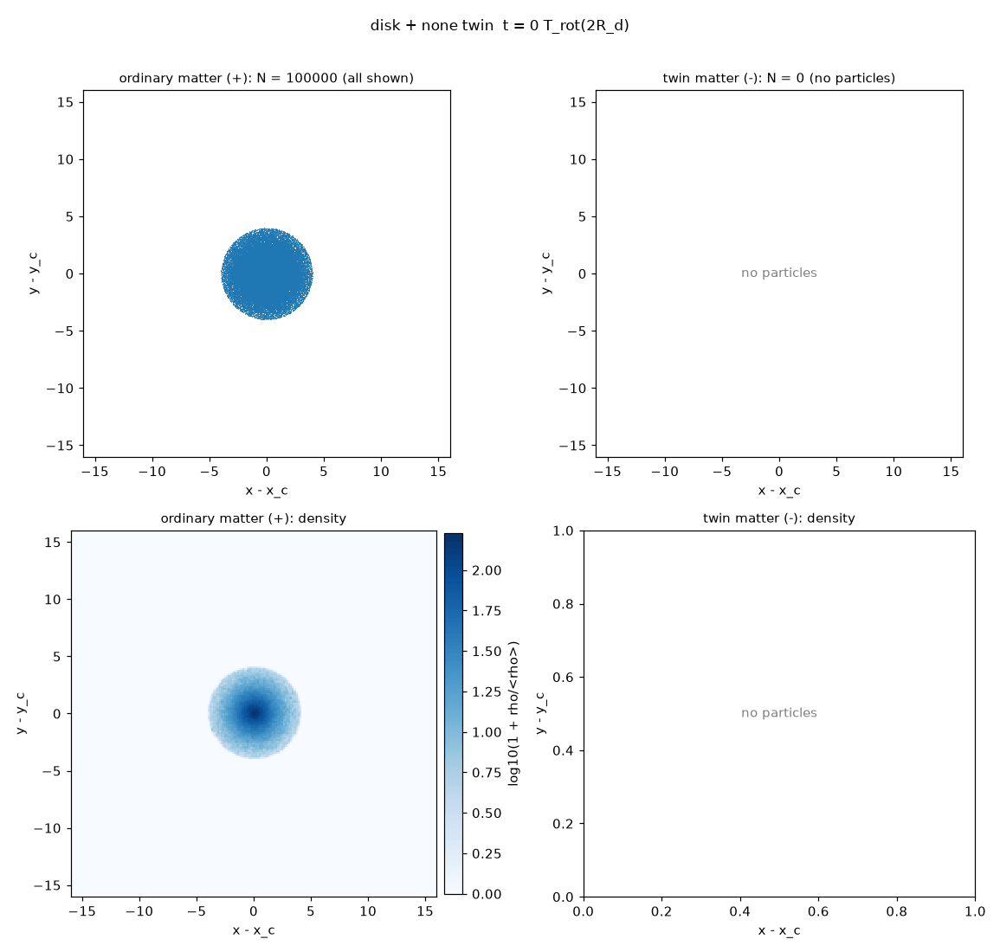
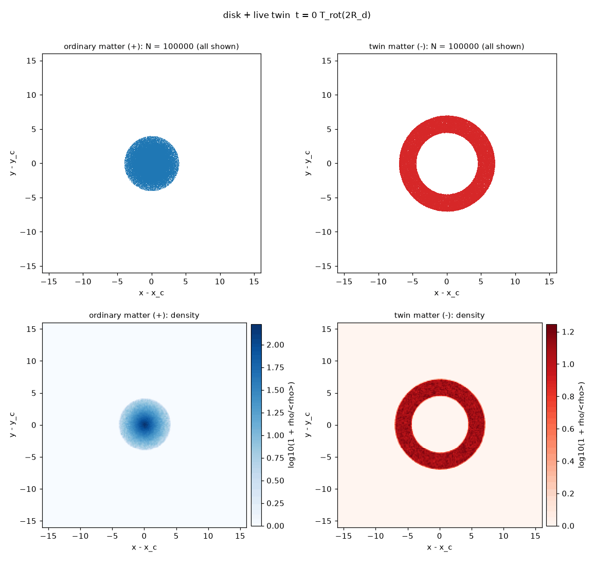

# Twin-matter N-body simulations: a reproduction and stress test

This repository reproduces, and then stress-tests, the 2-D N-body simulations of "twin matter" published by Jean-Pierre Petit and collaborators in the 1990s and early 2000s, in which a population of negative-mass particles interacts gravitationally with ordinary matter. It covers both of the original claims: a cellular large-scale structure, and a barred spiral galaxy kept stable by surrounding twin matter. The goal is neutral: find out how far the original results can be reproduced with modern numerical methods, and where they stop holding.

| Static box (original setup) | Expanding box, 8 Jeans lengths | Expanding box, 32 Jeans lengths, 60 Jeans times |
|---|---|---|
|  |  |  |

| Bare disk, no twin matter (torus) | Disk with live twin ring (torus) | Twin ring in open space |
|---|---|---|
|  |  |  |

## Summary of findings

**Cells form, robustly.** With Petit's interaction laws and parameters, the heavy negative-mass population collapses into clumps, ordinary matter is pushed out into walls around them, and a cellular pattern appears within about 2 to 3 negative Jeans times. This held in every run: five seeds, two timesteps, four box sizes, with and without expansion, at up to 12.8 million particles.

**In a static box, as in the original simulations, the cells are transient.** The negative clumps keep merging until a single box-sized clump remains, in every seed and box size tested. Under the original assumptions, the simulations support "cells form" but not "cells are stable". As far as our literature search found, this hierarchical merging has not been reported before for this model.

**With a cosmic expansion added (not part of the original setup), merging slows but does not stop.** A multi-cell network survives to the end of every expanding run, reproducibly across seeds. In the largest box (32 Jeans lengths, 60 Jeans times), the clump count falls from 78 to 22, with the merging rate dropping from about 30% to about 10-20% per 10 Jeans times but never reaching zero. The slowdown comes from the imposed expansion law, not from an equilibrium of the model.

**The large cells need twin matter.** Ordinary matter alone, under the same expansion, forms only fine-grained structure about a quarter of the size of the mixed run's cells.

**The galaxy result is not reproduced so far.** A bare disk with no twin matter already forms a bar and a spiral lasting 9 of 10 rotations, as classic galactic dynamics predicts. A twin-matter ring around the disk, set up as described in the original work, disperses within one rotation in open space; in the periodic torus used in the original runs, the twin matter makes the bar and spiral slightly *weaker*, not stronger or longer-lived. These runs cover 10 rotations, against the 30 to 50 turns claimed originally, and use a different disk setup, so this is suggestive rather than decisive.

All results are 2-D. The code also runs in 3-D and on the GPU.

## Background: the claims being tested

In the twin-matter (later "Janus") model, ordinary matter and twin matter of negative mass interact only through gravity, with three interaction laws: like masses attract, and positive and negative masses repel each other. The 2001 conference paper "Twin matter against dark matter" (Petit, Midy and Landsheat) describes 2-D simulations starting from uniform distributions of both populations (2 × 5,000 points), with the twin population 64 times denser and with a Jeans time eight times shorter. It reports a cellular large-scale structure described as remarkably stable in time, and a barred spiral galaxy, surrounded by twin matter, persisting for over 50 turns. Later accounts by the same authors give different details (equal densities in the first 1992 runs, 2 × 10,000 points and "thirty turns" for the galaxy). Run lengths, energy conservation, softening, timestep and the 2-D force law were not reported.

## Methodology

### Research pipeline

The project was carried out with a chain of AI-assisted steps, each written to a file in this repository so it can be inspected:

1. **Crawl** (`scriptscrape.py`): the author's website was crawled breadth-first and each page's text saved locally. The scraped content belongs to the site's author and is not included in this repository.
2. **Per-page analysis**: each page was summarized by Claude Haiku.
3. **Synthesis** (`synthesize.py`, output `final_report.md`): Claude Opus merged the summaries into a categorized report of the site.
4. **Investigation** (`investigate.py`, output `astrophysics_investigation.md`): Claude Fable carried out a neutral investigation of the computational astrophysics, focused on the twin-matter N-body simulations.
5. **Simulation design and code** (`build_sim.py`, outputs `simulation_notes.md` and `sim/`): Claude Fable designed the simulation from the investigation and the original pages, listing every assumption where the sources are vague, and wrote it as separate modules.
6. **GPU port** (`build_gpu.py` and `build_gpu_diag.py`, outputs `sim_gpu/` and `sim_gpu2/`): Claude Fable ported the forces, integrator and diagnostics to the GPU with PyTorch.
7. **Runs and validation**: simulations were run, tested and debugged as described below.
8. **Interpretation** (`interpret_run.py`, outputs `interpretation.md` in each run folder): Claude Fable reviewed each key run's snapshots alongside its measured data.
9. **Literature comparison**: a multi-source literature review (Claude research mode) compared the findings with published negative-mass simulations and critiques.

All simulation code was AI-generated and should be read with that in mind. It was validated through the convergence, control and CPU-versus-GPU tests below rather than line-by-line review.

### Numerical model

- **Method**: particle-mesh (PM) gravity with FFT, using the kernel -2πG/|k| (a razor-thin sheet with a 1/r² force law in the plane). Periodic or isolated (zero-padded) boundaries. A direct-summation mode is available for cross-checks.
- **Interaction laws**: same-sign masses attract; opposite-sign masses repel. Equations of motion use |m| as inertial mass, so the |m|-weighted momentum is conserved while the signed momentum is not.
- **Integrator**: leapfrog kick-drift-kick with a fixed timestep.
- **Large-scale structure**: periodic unit box; Poisson-uniform initial positions; twin-to-ordinary density ratio 64 and velocity dispersion ratio 4 (from the original work); the absolute velocity scale is set from the negative Jeans length relative to the box (assumed).
- **Galaxy**: a 2-D exponential disk (scale length R_d, truncated at 4 R_d, Toomre Q = 1.5) with velocities from the measured force field, surrounded by a non-rotating twin-matter ring between 4.5 and 7 R_d with the disk's mass. Controls: no twin matter, a fixed repulsive ring, and a fixed attractive halo. The original galaxy setup (an exact 2-D Vlasov equilibrium) was never published, so the disk and ring are assumptions.
- **Expansion (optional)**: comoving frame with a(t) ∝ t^(2/3). This is a standard kinematic expansion law, not one derived from the Janus model.
- **Precision**: float64 on the CPU; float32 on the GPU, validated against float64.

All assumptions (A1 to A17) are printed at the start of every run and saved as `assumptions.txt` in each output folder.

### Diagnostics

Each large-scale run records energy and momentum conservation, clump counts and masses, a segregation index, a persistence index and the dominant structure scale. Galaxy runs record bar and spiral strength, pitch angle, angular momentum, rotation curve, Toomre Q and escape fractions. Some pre-registered pass/fail criteria proved to be weak tests (pixel-level segregation weakens as walls thicken; persistence measured against t = 5 penalizes any merging), so the conclusions rely mainly on clump counts, structure scales, bar and spiral strengths, and the images.

### Validation

| Test | Result | Conclusion |
|---|---|---|
| Timestep convergence (static) | Energy error fell only 2× per halving | Not a timestep problem |
| Positives alone | 0.5% error | Force solver and integrator are sound |
| Negatives alone | 134% error | Problem appears with the collapsing population |
| Positives alone, rescaled to match the negatives exactly | Identical energy log, digit for digit | No sign bug in the energy calculation |
| Negatives alone, 5k / 20k / 80k particles | 134% / 40% / 9.7% | Discreteness heating: error ∝ 1/N |
| Mixed, 800k particles, 64² grid | Energy within about ±1% | Trustworthy baseline |
| Baseline and expansion runs with half timestep | All metrics unchanged | Converged in timestep |
| Galaxy, bare disk: periodic vs isolated boundaries | 108% vs 1.1% energy error | Galaxies need isolated boundaries |
| Galaxy, bare disk: total angular momentum | Conserved to about 5% | The apparent disk loss is redistribution outward by the bar |
| GPU vs CPU (forces, float64) | Agree to about 1e-15 | Exact port |
| GPU vs CPU (all diagnostics, float64) | Agree to about 1e-13 | Exact port |
| GPU baseline vs CPU baseline | Same metrics and energy history; 35 s vs 189 s | Validated for production |

The key lessons: the strongly unstable negative population needs about 200 particles per grid cell to avoid artificial heating, and isolated galaxies need open boundaries. Runs that ignore either produced misleading verdicts. In expanding runs, E = KE + U is not conserved by design, so timestep convergence is used as the accuracy check instead.

## Results: large-scale structure

### Static box (original setup)

| Run | Final negative clumps | Segregation | Notes |
|---|---|---|---|
| Baseline, 5 seeds | 1 in every seed | -0.64 to -0.76 | Cells at t ≈ 2-3, merge to one clump by t ≈ 7 |
| Half timestep | 1 | -0.69 | Identical to baseline |
| Box twice as large | 1 | -0.69 | Merging continues to box scale |
| Velocity ratio 1 | 1 | -0.74 | The positives' temperature hardly matters |

### Expanding box, 8 Jeans lengths across

| Seed | 1 | 2 | 3 | 4 | 5 | Mean |
|---|---|---|---|---|---|---|
| Final clumps | 4 | 3 | 5 | 4 | 4 | 4.0 ± 0.6 |
| Clump loss, t = 5 to 20 | -64% | -57% | -67% | -64% | -67% | -64% ± 3% |

### Long expanding runs (60 Jeans times)

| Time (Jeans times) | 10 | 20 | 30 | 40 | 50 | 60 |
|---|---|---|---|---|---|---|
| Clumps, 16 Jeans lengths | 29 | 14 | 12 | 8 | 7 | 7 |
| Clumps, 32 Jeans lengths | 78 | 50 | 35 | 31 | 25 | 22 |
| Dominant scale, 32 Jeans lengths (fraction of box) | 0.14-0.2 | 0.2 | 0.2-0.25 | 0.2-0.25 | 0.25-0.33 | 0.33 |

Up to about 30 Jeans times, clump density per unit area agrees between the two boxes to within about 10%. Afterwards the smaller box stops at 7 clumps because its structure reaches box scale, while in the larger box merging continues, slowing from about 30% to about 10-20% per 10 Jeans times.

### Positives-only control (32 Jeans lengths, expansion)

Ordinary matter alone forms only fine-grained structure (dominant scale 0.08 of the box against 0.25-0.33 in the mixed run). The large cells require twin matter.

## Results: the galaxy

All runs: 100,000 disk particles (and 100,000 twin particles where present), box 32 R_d, 512² grid, 10 rotations at 2 R_d, GPU in float32.

| | Bare disk (isolated) | Live twin ring (isolated) | Bare disk (torus) | Live twin ring (torus) |
|---|---|---|---|---|
| Bar strength (final) | 0.40 | 0.41 | 0.42 | 0.36 |
| Spiral strength (late) | 0.27 | 0.25 | 0.17 | 0.13 |
| Rotations with spiral | 9 | 9 | 9 | 9 |
| Pitch angle | 53° | 54° | 45° | 36° |

**In open space, the twin ring does not survive.** It is not rotating, its own gravity is too weak to bind it (its Jeans length, 9.6 R_d, exceeds its width, 2.5 R_d), and the disk repels it. Its rms radius grows from 5.9 R_d to 11.8 R_d after one rotation and 135 R_d by the end, so for 9 of the 10 rotations the disk is effectively bare, which is why the two isolated runs match.

**In the periodic torus**, twin matter cannot escape and surrounds the galaxy, but it makes the bar and spiral somewhat weaker than in the bare disk.

**A bare disk forms a bar and a spiral lasting 9 of 10 rotations by itself**, in every setup tested, consistent with the classic bar instability of cold disks. A heavy rigid halo suppresses both, as Ostriker and Peebles (1973) found. So a barred spiral lasting several turns is not by itself evidence for twin matter.

Open questions: runs of 30 to 50 rotations as claimed originally, a self-bound (colder or rotating) twin ring, a setup closer to the original Vlasov equilibrium galaxy, the assumed disk temperature and ring mass, and a live (particle) halo as a control, since rigid halos can stabilize disks artificially.

## Comparison with the literature

A literature review found no published independent re-run of Petit's three-law 2-D setup, and no peer-reviewed study testing whether a negative-mass environment confines or stabilizes disk galaxies.

- **Same interaction rule, different setup.** Manfredi et al. (2018) simulated the rule used here (called the "antiplasma" case in their classification) in 1-D with equal densities: the two populations separated globally into opposite-moving streams, which they took as a reason to reject that scenario.
- **Different rules.** Their other 1-D simulations (Dirac-Milne and Bondi masses) and the 3-D Dirac-Milne simulations of Chardin et al. (2021) find structure formation that starts earlier and stops, and flat rotation curves for spherical structures; none of these simulate disks, bars or spirals. Farnes (2018) reported flat rotation curves from Bondi-type negative-mass halos in 3-D, but Socas-Navarro (2019) found a force-law bug in that code and, after correcting it, obtained Keplerian rotation curves.
- **Agreement with classic results.** Cell formation agrees with the original 2001 report. The galaxy results agree with the classic bar-instability literature (Hohl 1971; Ostriker and Peebles 1973), and the discreteness heating found at small particle numbers is consistent with the general N-body literature (Fujii et al. 2011; Sellwood 2012). Hierarchical merging is standard for self-gravitating systems, and the original paper itself quotes Peebles's warning that first-generation structures are transient.
- **New here.** The hierarchical merging of the cells in Petit's setup, its slowdown under expansion, the role of discreteness heating at the original particle numbers, and the galaxy tests with controls.
- **Wider context.** The Janus model's observational support rests mainly on a supernova fit by its own authors (D'Agostini and Petit 2018); no published fits to the CMB power spectrum or baryon acoustic oscillations were found. Its theoretical consistency has been challenged (Damour 2019; Hohmann and Wohlfarth 2009; Luminet 2026), and the Janus authors have responded to each.

## Runs of interest

Folders are under `sim/out/` (CPU) or `sim_gpu*/out/` (GPU). Each contains `summary.json`, `assumptions.txt`, the diagnostics and structure CSVs, and, for key runs, Fable's `interpretation.md`.

| Run | Folder | What it shows |
|---|---|---|
| Static baseline (trusted) | `sim/out/lss_20261015_022818` | Cells form, then merge to one clump |
| Static seed ensemble | `sim/out/ensemble_lss_20261015_025231` | One clump in every seed |
| Static, half timestep | `sim/out/lss_20261015_031229` | Timestep convergence |
| Static, 16 Jeans lengths | `sim/out/lss_20261015_032114` | Merging continues to box scale |
| Expansion, 8 Jeans lengths | `sim/out/lss_20261015_033603` | Multi-clump network survives |
| Expansion, half timestep | `sim/out/lss_20261015_041623` | Timestep convergence with expansion |
| Expansion seed ensemble | `sim/out/ensemble_lss_20261015_042512` | 4.0 ± 0.6 clumps across seeds |
| Expansion, 16 Jeans lengths, 60 Jeans times | `sim/out/lss_20261015_124906` | Apparent plateau at 7 clumps (box-limited) |
| Expansion, 32 Jeans lengths, 60 Jeans times | `sim/out/lss_20261016_001718` | Coarsening slows but continues |
| Positives-only control | `sim_gpu/out/lss_20261016_114225` | Large cells need twin matter |
| Negatives alone, 5k / 20k / 80k | `sim/out/lss_20261014_231516`, `lss_20261015_000010`, `lss_20261015_021353` | Discreteness heating ∝ 1/N |
| Rescaled positives control | `sim/out/lss_20261014_234956` | No sign bug in the energy |
| GPU baseline | `sim_gpu2/out/lss_20261016_132701` | GPU reproduces the CPU baseline |
| Galaxy, bare disk, isolated | `sim_gpu2/out/galaxy_20261016_141050` | Bar and spiral without twin matter |
| Galaxy, live ring, isolated | `sim_gpu2/out/galaxy_20261016_141132` | The twin ring disperses |
| Galaxy, bare disk, torus | `sim_gpu2/out/galaxy_20261016_141719` | Baseline for the original setup |
| Galaxy, live ring, torus | `sim_gpu2/out/galaxy_20261016_141631` | Twin matter slightly weakens the spiral |
| Galaxy, rigid halo (5k) | `sim_gpu2/out/galaxy_20261016_140102` | A heavy halo suppresses bar and spiral |
| Galaxy, periodic vs isolated boundaries | `sim_gpu2/out/galaxy_20261016_140319`, `galaxy_20261016_140516` | Why galaxies need isolated boundaries |

## What this says about the original claims

The mechanism Petit described for large-scale structure is reproducible and robust: twin matter clumps, ordinary matter is confined to walls, and a cellular pattern forms quickly. The stability he reported is not reproduced under his assumptions: in a static box, the cells merge until one clump remains, and with an added expansion law the merging slows but continues. The galaxy claim is not supported so far: the bare disk already forms a lasting bar and spiral, and the twin matter either disperses or slightly weakens the structure, although longer runs with a setup closer to the original are still needed. The simulations do not test the claims about dark matter, galaxy rotation curves or the observed cosmic web.

## Limitations

- 2-D only; the original work was also 2-D, but real structure formation is 3-D.
- Many parameters of the original runs were never published and were assumed here, including the galaxy's initial setup, run lengths and the 2-D force law.
- The expansion law is a generic kinematic one, not derived from the Janus model.
- The galaxy runs are 10 rotations long, shorter than the 30 to 50 turns claimed originally, and the rigid-repulsive control shows an unexplained energy drift that needs investigating.
- Some diagnostics have known weaknesses (see above).
- No quantitative comparison with observations has been made.

## Reproducing

Requirements: Python 3.12, numpy, scipy, matplotlib (and anthropic for the AI pipeline scripts, with `ANTHROPIC_API_KEY` set in the environment). The GPU version additionally needs ROCm and AMD's ROCm build of PyTorch (tested with ROCm 7.2 and PyTorch 2.9.1 under WSL on Ubuntu 24.04).

```bash
python -m venv venv && source venv/bin/activate
pip install numpy scipy matplotlib anthropic
cd sim_gpu2
python main.py --help
python main.py assumptions lss

# Large-scale structure: trusted static baseline (about 3 minutes on the CPU)
python main.py lss --grid 64 --npos 400000 --nneg 400000

# Expansion, 32 Jeans lengths, 60 Jeans times (GPU)
python main.py lss --device gpu --grid 256 --npos 6400000 --nneg 6400000 --lambda-j-neg 0.03125 --expansion --tmax 60

# Galaxy: bare disk and live twin ring, isolated boundaries (GPU)
python main.py galaxy --device gpu --bc isolated --box 32 --grid 512 --ndisk 100000 --control none
python main.py galaxy --device gpu --bc isolated --box 32 --grid 512 --ndisk 100000 --ntwin 100000

# Validation
python main.py gputest
python main.py diagtest
```

## Repository layout

- `scriptscrape.py`, `synthesize.py`, `investigate.py`, `build_sim.py`: AI research pipeline
- `build_gpu.py`, `build_gpu_diag.py`, `export_promt.py`: GPU port pipeline
- `final_report.md`, `astrophysics_investigation.md`, `simulation_notes.md`, `gpu_plan.md`, `gpu_diag_plan.md`: pipeline outputs
- `sim/`: CPU simulation (the validated reference) and its run outputs
- `sim_gpu/`: first GPU version (forces and integrator)
- `sim_gpu2/`: current GPU version (forces, integrator and diagnostics), including the galaxy runs
- `media/`: animations shown above

## References

Original work and the Janus model:

1. Petit, J.-P. (1994). "The missing-mass problem". *Il Nuovo Cimento B* 109, 697.
2. Petit, J.-P., Midy, P., Landsheat, F. (2001). "Twin matter against dark matter". Marseille Cosmology Conference *Where's the Matter?* https://januscosmologicalmodel.com/pdf/2001-where-is-the-matter.pdf
3. Petit, J.-P., d'Agostini, G. (2014). "Negative mass hypothesis in cosmology and the nature of dark energy". *Modern Physics Letters A* 29, 1450182.
4. D'Agostini, G., Petit, J.-P. (2018). "Constraints on Janus Cosmological model from recent observations of supernovae type Ia". *Astrophysics and Space Science* 363, 139.
5. Petit, J.-P., d'Agostini, G., Debergh, N. (2019). "Physical and mathematical consistency of the Janus Cosmological Model". *Progress in Physics* 15, 38.
6. Petit, J.-P., Margnat, F., Zejli, H. (2024). *European Physical Journal C* 84, 1226.
7. Janus Cosmological Model reference list: https://januscosmologicalmodel.com/map
8. Author's website (source of the crawled pages): http://www.jp-petit.org

Other negative-mass simulations and critiques:

9. Manfredi, G., Rouet, J.-L., Miller, B., Chardin, G. (2018). "Cosmological structure formation with negative mass". *Physical Review D* 98, 023514.
10. Manfredi, G., Rouet, J.-L., Miller, B. N., Chardin, G. (2020). "Structure formation in a Dirac-Milne universe: comparison with the standard cosmological model". *Physical Review D* 102, 103518.
11. Chardin, G., Dubois, Y., Manfredi, G., Miller, B., Stahl, C. (2021). "MOND-like behavior in the Dirac-Milne universe". *Astronomy & Astrophysics* 652, A91.
12. Manfredi, G., Rouet, J.-L., Miller, B. (2026). "The Bondi universe: How negative mass drives the cosmological expansion". arXiv:2601.22910.
13. Farnes, J. S. (2018). "A unifying theory of dark energy and dark matter: negative masses and matter creation within a modified ΛCDM framework". *Astronomy & Astrophysics* 620, A92.
14. Socas-Navarro, H. (2019). "Can a negative-mass cosmology explain dark matter and dark energy?" *Astronomy & Astrophysics* 626, A5.
15. Nájera, S., Gamboa, A., Aguilar-Nieto, A., Escamilla-Rivera, C. (2021). "On negative mass cosmology in General Relativity". *Astronomy & Astrophysics* 651, L13.
16. Piran, T. (1997). "On gravitational repulsion". *General Relativity and Gravitation* 29, 1363.
17. Dubinski, J., da Costa, L. N., Goldwirth, D. S., Lecar, M., Piran, T. (1993). "Void evolution and the large-scale structure". *Astrophysical Journal* 410, 458.
18. Hohmann, M., Wohlfarth, M. N. R. (2009). "Repulsive gravity model for dark energy". *Physical Review D* 80, 104011.
19. Damour, T. (2019). Note on the Janus model (IHES, not peer reviewed).
20. Luminet, J.-P. (2026). "Twin Universes and Bimetric Gravity: From Sakharov's Cosmological Symmetry to Modern Speculations on Negative Mass". arXiv:2609.26834.
21. Bondi, H. (1957). "Negative mass in general relativity". *Reviews of Modern Physics* 29, 423.

Galactic dynamics and numerical methods:

22. Hohl, F. (1971). "Numerical experiments with a disk of stars". *Astrophysical Journal* 168, 343.
23. Ostriker, J. P., Peebles, P. J. E. (1973). "A numerical study of the stability of flattened galaxies: or, can cold galaxies survive?" *Astrophysical Journal* 186, 467.
24. Sellwood, J. A., Carlberg, R. G. (1984). "Spiral instabilities provoked by accretion and star formation". *Astrophysical Journal* 282, 61.
25. Athanassoula, E. (2002). "Bar-halo interaction and bar growth". *Astrophysical Journal* 569, L83.
26. Fujii, M. S., et al. (2011). "Unprecedented long-lived spiral arms in N-body simulations". *Astrophysical Journal* 730, 109.
27. Sellwood, J. A. (2012). "Transient spirals as superposed instabilities". *Astrophysical Journal* 751, 44.
28. Sellwood, J. A. (2025). "After 54 years of bar instability studies: a fresh surprise". arXiv:2510.20574.
29. Hockney, R. W., Eastwood, J. W. (1988). *Computer Simulation Using Particles*. Taylor & Francis.
30. Binney, J., Tremaine, S. (2008). *Galactic Dynamics*, 2nd ed. Princeton University Press.
