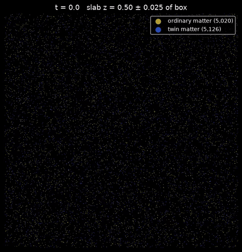
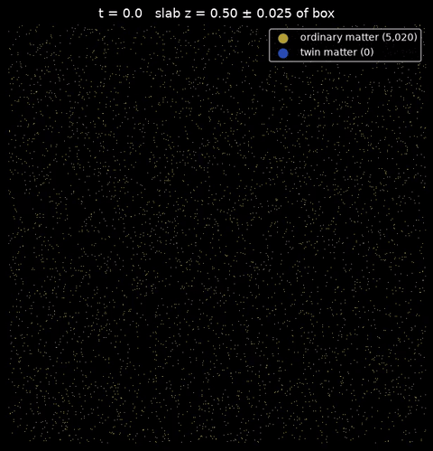
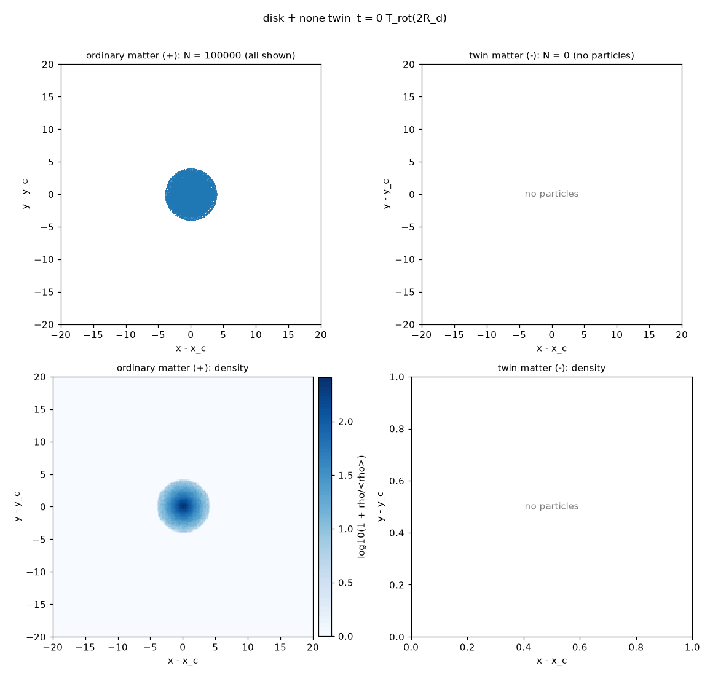
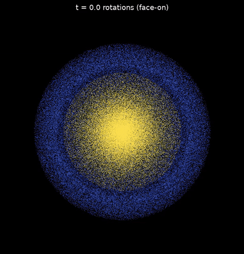
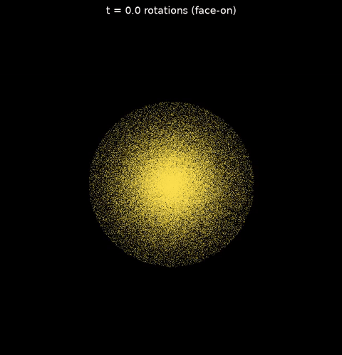
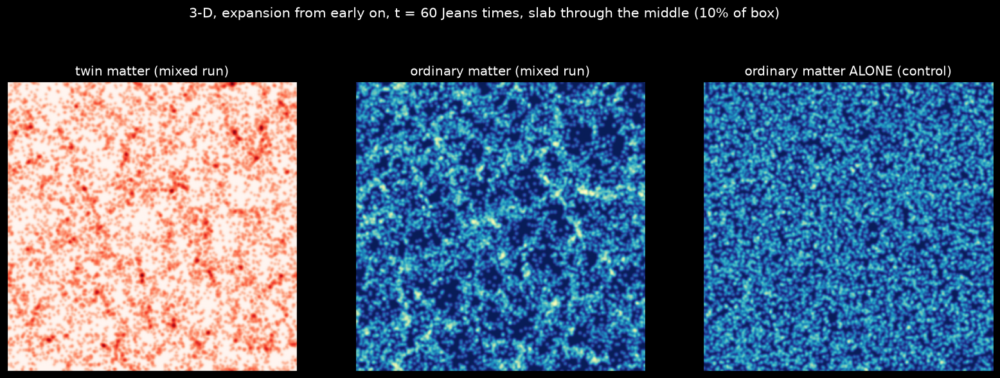
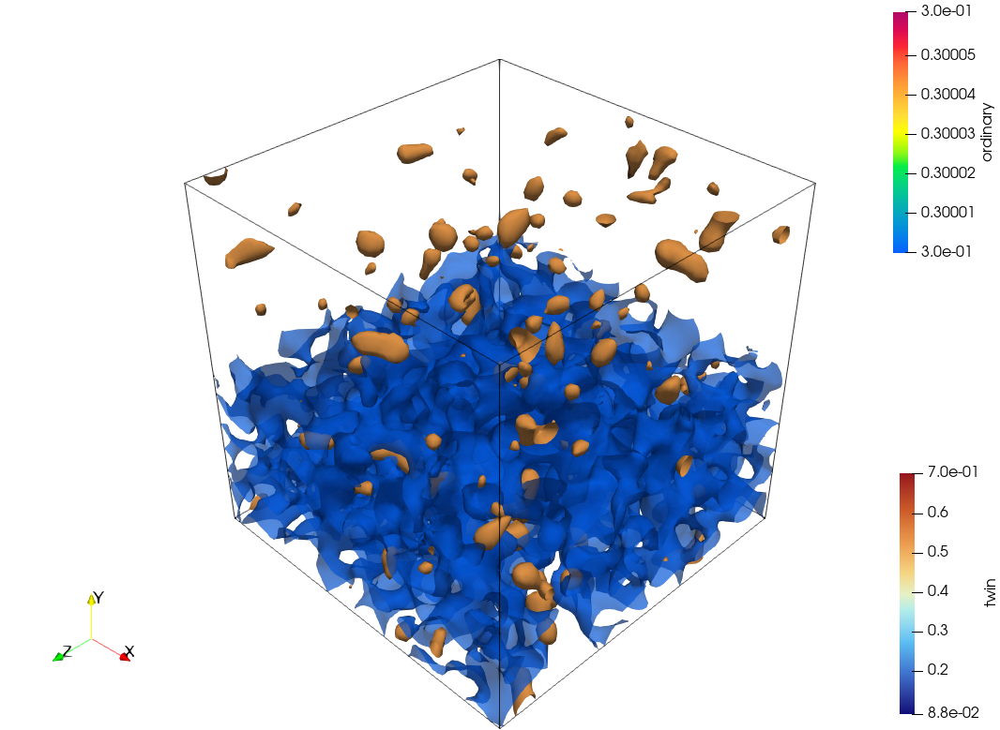
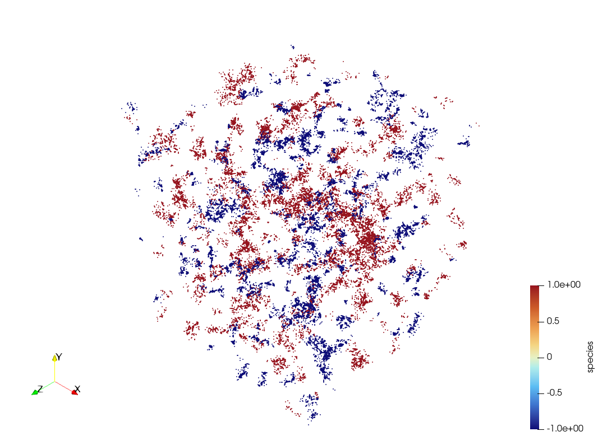

# Twin-matter N-body simulations: a reproduction and stress test

This repository reproduces, and then stress-tests, the 2-D N-body simulations of "twin matter" published by Jean-Pierre Petit and collaborators in the 1990s and early 2000s, in which a population of negative-mass particles interacts gravitationally with ordinary matter, and extends them to 3-D. It covers both of the original claims: a cellular large-scale structure, and a barred spiral galaxy kept stable by surrounding twin matter. The goal is neutral: find out how far the original results can be reproduced with modern numerical methods, and where they stop holding.

**2-D large-scale structure**

| Static box (original setup) | Expanding box, 8 Jeans lengths | Expanding box, 32 Jeans lengths, 60 Jeans times |
|---|---|---|
|  |  |  |

**3-D large-scale structure (slice through the box; yellow: ordinary matter, blue: twin matter)**

| With twin matter, expansion from early on | Ordinary matter alone, same setup |
|---|---|
|  |  |

**Galaxies**

| 2-D: twin shell, Petit-like setup | 2-D: same disk, no twin matter |
|---|---|
|  |  |

| 3-D cold disk with twin shell (face-on) | 3-D cold disk, no twin matter (face-on) |
|---|---|
|  |  |

## Summary of findings

**Cells form, robustly.** With Petit's interaction laws and parameters, the heavy twin population collapses into clumps and ordinary matter is pushed into the space between them. This held in every 2-D run (five seeds, two timesteps, four box sizes, with and without expansion, up to 12.8 million particles) and in 3-D.

**In a static box, as in the original simulations, the cells are transient.** The twin clumps merge until a single box-sized clump remains, in every seed and box size tested, in 2-D and 3-D (in 3-D within about 3 Jeans times). The simulations support "cells form" but not "cells are stable". As far as our literature search found, this merging has not been reported before for this model.

**With a cosmic expansion added (not part of the original setup), the picture changes.** In 2-D, merging slows but never stops within 60 Jeans times. In 3-D, the outcome depends on when expansion starts: starting at 1 Jeans time, the twin matter still collapses globally first; starting at 0.1 Jeans time, roughly what a matter-dominated universe of this density implies, the populations separate early, twin clumps form gradually, and ordinary matter then forms its own clumps in the gaps, giving an interleaved network of 902 twin and 295 ordinary clumps at 60 Jeans times, with no merging. **Ordinary matter alone, in the same setup, forms no clumps at all**, so in 3-D the twin matter drives the formation of ordinary-matter structure. This is the strongest support the project found for the original mechanism, with the caveat that it depends on an expansion law that is not derived from the Janus model.

**The galaxy result is not reproduced, in 2-D or 3-D.** Bare disks form bars and, when cold, spiral arms, without any twin matter. A setup resembling the original animation reproduces its sequence (a twin shell fragmenting into clumps that move away from the galaxy), but the bar ends identical with and without twin matter. In 3-D, twin matter triggers the bar a few rotations earlier and leaves it weaker, and makes no difference to spiral arms. The one genuine twin-matter effect is braking of the galaxy's rotation in 2-D, by close passes of twin clumps.

## Background: the claims being tested

In the twin-matter (later "Janus") model, ordinary matter and twin matter of negative mass interact only through gravity, with three interaction laws: like masses attract, and positive and negative masses repel each other. The 2001 conference paper "Twin matter against dark matter" (Petit, Midy and Landsheat) describes 2-D simulations starting from uniform distributions of both populations (2 × 5,000 points), with the twin population 64 times denser and with a Jeans time eight times shorter. It reports a cellular large-scale structure described as remarkably stable in time, and a barred spiral galaxy, surrounded by twin matter, persisting for over 50 turns. Later accounts by the same authors give different details (equal densities in the first 1992 runs, 2 × 10,000 points and "thirty turns" for the galaxy). Run lengths, energy conservation, softening, timestep and the 2-D force law were not reported. The original work was 2-D only; 3-D was described as beyond the means available at the time.

## Methodology

### Research pipeline

The project was carried out with a chain of AI-assisted steps, each written to a file in this repository so it can be inspected:

1. **Crawl** (`scriptscrape.py`): the author's website was crawled and each page's text saved locally. The scraped content belongs to the site's author and is not included here.
2. **Per-page analysis** (Claude Haiku) and **synthesis** (`synthesize.py`, Claude Opus, output `final_report.md`).
3. **Investigation** (`investigate.py`, Claude Fable, output `astrophysics_investigation.md`): a neutral investigation of the twin-matter N-body simulations.
4. **Simulation design and code** (`build_sim.py`, Claude Fable, outputs `simulation_notes.md` and `sim/`), listing every assumption where the sources are vague.
5. **GPU port** (`build_gpu.py`, `build_gpu_diag.py`, Claude Fable, outputs `sim_gpu/` and `sim_gpu2/`).
6. **Runs, validation and debugging**, as described below.
7. **Interpretation** (`interpret_run.py`, Claude Fable) of key 2-D runs from their snapshots and data.
8. **Literature comparison** with published negative-mass simulations and critiques (Claude research mode).

All simulation code was AI-generated. It was validated through convergence, control and CPU-versus-GPU tests rather than line-by-line review.

### Numerical model

- **Method**: particle-mesh (PM) gravity with FFT, periodic or isolated (zero-padded) boundaries. In 2-D, the kernel is -2πG/|k| (a razor-thin sheet with a 1/r² force in the plane); in 3-D, the standard Newtonian kernel -4πG/k².
- **Interaction laws**: same-sign masses attract; opposite-sign masses repel. Equations of motion use |m| as inertial mass.
- **Integrator**: leapfrog kick-drift-kick with a fixed timestep.
- **Large-scale structure**: periodic unit box; Poisson-uniform initial positions; twin-to-ordinary density ratio 64 and velocity dispersion ratio 4 (from the original work); the velocity scale is set from the twin Jeans length relative to the box (assumed).
- **Galaxy**: an exponential disk (2-D, or 3-D with a sech² vertical profile) with velocities from the measured force field, surrounded by a non-rotating twin shell with the disk's mass. Controls: no twin matter, a fixed repulsive ring, and a fixed attractive halo. The original galaxy setup was never published, so the disk and shell are reconstructions.
- **Expansion (optional)**: comoving frame with a(t) ∝ t^(2/3) from a chosen start time. This is a standard matter-dominated law, not one derived from the Janus model.
- **Precision**: float64 on the CPU; float32 on the GPU, validated against float64.

All assumptions (A1 to A17) are printed at the start of every run and saved as `assumptions.txt` in each output folder.

### Validation

| Test | Result | Conclusion |
|---|---|---|
| 2-D: positives alone | 0.5% energy error | Force solver and integrator are sound |
| 2-D: rescaled positives matching the negatives exactly | Identical energy log | No sign bug in the energy calculation |
| 2-D: negatives alone, 5k / 20k / 80k particles | 134% / 40% / 9.7% energy error | Discreteness heating: error ∝ 1/N |
| 2-D: mixed, 800k particles; half timestep | Energy within ±1%; metrics unchanged | Trustworthy and converged |
| 2-D galaxy: periodic vs isolated boundaries | 108% vs 1.1% energy error | Galaxies need isolated boundaries for clean results |
| 3-D: negatives alone, 2M vs 8M particles | Same error | Particle count is not limiting in 3-D |
| 3-D: timestep 0.02 / 0.005 / adaptive | Energy drift ≈ 40% / under 1% / 0.3% of the kinetic energy | 3-D collapse needs dt = 0.005 |
| 3-D: mixed, 8M particles, dt = 0.005 | Drift 1.1% of the kinetic energy | Trustworthy |
| 3-D galaxies | Energy conserved to 0.02-0.15% | Excellent |
| GPU vs CPU (forces and all diagnostics, float64) | Agree to 1e-15 and 1e-13 | Exact port |
| GPU baseline vs CPU baseline | Same metrics; 35 s vs 189 s | Validated for production |

In expanding runs, E = KE + U is not conserved by design, so timestep convergence is the accuracy check (done in 2-D; still to be repeated in 3-D).

## Results: 2-D large-scale structure

### Static box (original setup)

| Run | Final twin clumps | Segregation | Notes |
|---|---|---|---|
| Baseline, 5 seeds | 1 in every seed | -0.64 to -0.76 | Cells at t ≈ 2-3, merge to one clump by t ≈ 7 |
| Half timestep | 1 | -0.69 | Identical to baseline |
| Box twice as large | 1 | -0.69 | Merging continues to box scale |

### Expanding box

Across five seeds in a box 8 Jeans lengths across, every run keeps 3 to 5 clumps (mean 4.0 ± 0.6) where static runs end with one.

| Time (Jeans times) | 10 | 20 | 30 | 40 | 50 | 60 |
|---|---|---|---|---|---|---|
| Clumps, 16 Jeans lengths | 29 | 14 | 12 | 8 | 7 | 7 |
| Clumps, 32 Jeans lengths | 78 | 50 | 35 | 31 | 25 | 22 |

Up to about 30 Jeans times, the two boxes agree. Afterwards the smaller box stops at 7 clumps because its structure reaches box scale, while in the larger box merging continues, slowing from about 30% to about 10-20% per 10 Jeans times.

**Positives-only control:** ordinary matter alone forms only fine-grained structure, a quarter of the size of the mixed run's cells.

## Results: 3-D large-scale structure

### Static box

In a box 8 Jeans lengths across, the twin matter collapses and merges into a single clump within about 3 Jeans times, faster than in 2-D. In 3-D, all scales larger than the Jeans length grow at about the same rate, so the whole box collapses almost at once, while in the 2-D sheet large scales grow more slowly and structure builds up step by step.

### Expanding box (16 Jeans lengths across)

With expansion starting at 1 Jeans time, the twin matter still collapses globally first (120 clumps at 1 Jeans time, one by 3), ordinary matter forms about 15 separate clumps, and the populations barely separate (segregation -0.05).

With expansion starting at 0.1 Jeans time, closer to what a matter-dominated universe of the twin matter's density implies, the evolution is gradual:

| Jeans times | 5 | 10 | 20 | 30 | 40 | 50 | 60 |
|---|---|---|---|---|---|---|---|
| Twin clumps | 0 | 7 | 185 | 475 | 664 | 804 | 902 |
| Ordinary clumps, with twin matter | 0 | 0 | 1 | 26 | 92 | 197 | 295 |
| **Ordinary clumps, ordinary matter alone** | 0 | 0 | 0 | 0 | 0 | 0 | **0** |
| Segregation | -0.82 | -0.80 | -0.73 | -0.67 | -0.63 | -0.59 | -0.56 |

The sequence is: the two populations separate early, while still nearly smooth; twin clumps form from about 10 Jeans times; ordinary matter then forms its own clumps in the gaps from about 25 Jeans times. There is no merging within 60 Jeans times, and the dominant structure scale stays at about 4 Jeans lengths. In the control, ordinary matter alone forms no clumps, because on its own its collapse is eight times slower and the expansion suppresses it further. The twin matter's repulsion compresses ordinary matter into the gaps between twin clumps, which lets it collapse.







In 3-D, ordinary matter forms separate clumps between the twin clumps rather than continuous walls enclosing cells, as in the original 2-D pictures. The decline of the segregation index over time appears to be a property of the index as both populations concentrate into small clumps, rather than mixing.

Caveats: single seed; the expansion law is generic; the result depends on when expansion starts; and the dt = 0.005 timestep has been validated in 3-D without expansion only.

## Results: galaxies

### 2-D

- **The structure is a bar, not spiral arms**, in the 2-D runs (pitch angles near 75-90°); the code's "spiral" measure was counting the bar.
- **A bare disk forms a bar lasting 50 rotations at constant strength** in isolated boxes (0.4-0.5% energy error), so a long-lived barred structure does not require twin matter.
- **Bars decay in the periodic torus but not in open space**, with or without twin matter, at both box sizes tested: a property of periodic boxes.
- **A hot, non-rotating twin ring disperses in open space** within one rotation; in the torus, twin matter fills the box with a void around the galaxy and the bar forms weaker.
- **Petit-like setup** (cold twin shell, torus 40 R_d across): the shell fragments into clumps that are pushed to the box edges around a barred galaxy, closely resembling the original animation, then merge into one distant clump. The bar ends identical with and without twin matter (0.21); the disk loses more angular momentum with twin matter (-65% against -46%), matching the original report that the galaxy's rotation slowed.

### 3-D

**Coarse grid (256³), thick disk (0.25 R_d), Q = 1.5, 30 rotations:** bar strength every few rotations.

| Rotation | 0 | 6 | 8 | 10 | 14 | 16 | 18 | 24 | 30 |
|---|---|---|---|---|---|---|---|---|---|
| Twin shell | 0.01 | 0.11 | 0.33 | 0.43 | 0.47 | 0.39 | 0.29 | 0.31 | 0.30 |
| Bare disk | 0.01 | 0.02 | 0.02 | 0.10 | 0.49 | 0.51 | 0.51 | 0.41 | 0.40 |

The twin shell triggers the bar about 4 rotations earlier; the peak strength is about the same; afterwards the twin-shell bar settles about a quarter weaker.

**Fine grid (512³), thin disk (0.15 R_d), cold disk (Q = 1.1), 15 rotations:** genuine spiral arms form (pitch angles 33-38°).

| | Bare disk | Twin shell |
|---|---|---|
| Pitch angle | 38° | 33° |
| Spiral strength (late) | 0.106 | 0.098 |
| Bar strength (final) | 0.263 | 0.265 |
| Rotations with spiral structure | 11 | 10 |

Twin matter makes essentially no difference to the spiral arms.

## Comparison with the literature

A literature review found no published independent re-run of Petit's three-law setup, and no peer-reviewed study testing whether a negative-mass environment confines or stabilizes disk galaxies.

- **Same interaction rule, different setup.** Manfredi et al. (2018) simulated this rule (the "antiplasma" case in their classification) in 1-D with equal densities: the two populations separated globally into opposite-moving streams.
- **Different rules.** Their 1-D Dirac-Milne and Bondi simulations and the 3-D Dirac-Milne simulations of Chardin et al. (2021) find structure formation that starts earlier and stops, and flat rotation curves for spherical structures, but no disks or spirals. Farnes (2018) reported flat rotation curves from Bondi-type negative-mass halos; Socas-Navarro (2019) found a force-law bug in that code and, after correcting it, obtained Keplerian rotation curves.
- **Agreement with classic results.** The galaxy results agree with the classic bar-instability literature (Hohl 1971; Ostriker and Peebles 1973); the discreteness heating at small particle numbers is consistent with the general N-body literature (Fujii et al. 2011; Sellwood 2012).
- **New here.** The merging of the cells in the original setup, its dependence on expansion, the 3-D behavior (global collapse in static boxes, and twin-driven ordinary structure with early expansion), and the galaxy tests with controls.
- **Wider context.** The Janus model's observational support rests mainly on a supernova fit by its own authors; no published fits to the CMB power spectrum or baryon acoustic oscillations were found. Its theoretical consistency has been challenged (Damour 2019; Hohmann and Wohlfarth 2009; Luminet 2026), and the Janus authors have responded to each. The Janus authors interpret the observed Dipole Repeller as a twin-matter conglomerate; standard cosmology explains it as a void, and lensing would distinguish the two.

## What this says about the original claims

The mechanism Petit described for large-scale structure is reproducible: twin matter clumps and ordinary matter ends up in the space between. The stability he reported is not reproduced under his assumptions: in a static box the cells merge until one clump remains, in 2-D and 3-D. With an expansion law added from early times, 3-D simulations produce an interleaved network in which twin matter drives the formation of ordinary-matter clumps, which supports the mechanism, though not yet a stable structure, and only under an expansion law the original work did not specify. The galaxy claim is not supported: bars and spiral arms form without twin matter, and twin matter neither creates nor sustains them. The simulations do not test the claims about dark matter, galaxy rotation curves or the observed cosmic web.

## Limitations

- Many parameters of the original runs were never published and were assumed here, including the galaxy's initial setup, run lengths and the 2-D force law.
- The expansion law is a generic kinematic one, not derived from the Janus model, and the 3-D result depends on when it starts.
- Most 3-D runs and many galaxy runs are single seeds; the 3-D timestep has not yet been validated with expansion.
- 3-D galaxies use periodic boundaries and a coarser vertical resolution than ideal.
- Some diagnostics have known weaknesses (the "spiral" measure counts bars; pixel-level segregation weakens as structures concentrate; persistence depends on the reference time).
- No quantitative comparison with observations has been made.

## Runs of interest

Folders are under `sim/out/` (CPU) or `sim_gpu*/out/` (GPU). Each contains `summary.json`, `assumptions.txt` and the diagnostics and structure CSVs; GPU runs since the visualization patch also save particle samples (`pts_*.npz`, not in git).

| Run | Folder | What it shows |
|---|---|---|
| 2-D static baseline | `sim/out/lss_20261015_022818` | Cells form, then merge to one clump |
| 2-D static seed ensemble | `sim/out/ensemble_lss_20261015_025231` | One clump in every seed |
| 2-D expansion seed ensemble | `sim/out/ensemble_lss_20261015_042512` | 4.0 ± 0.6 clumps across seeds |
| 2-D expansion, 32 Jeans lengths | `sim/out/lss_20261016_001718` | Coarsening slows but continues |
| 2-D positives-only control | `sim_gpu/out/lss_20261016_114225` | Large cells need twin matter |
| 2-D discreteness tests | `sim/out/lss_20261014_231516`, `lss_20261015_000010`, `lss_20261015_021353` | Heating ∝ 1/N |
| GPU baseline | `sim_gpu2/out/lss_20261016_132701` | GPU reproduces the CPU baseline |
| 2-D galaxy, bare disk, 50 rotations | `sim_gpu2/out/galaxy_20261016_145041` | Bar lasts 50 rotations without twin matter |
| 2-D galaxy, Petit-like pair | `sim_gpu2/out/galaxy_20261016_151616`, `galaxy_20261016_151915` | Reproduces the original sequence; same final bar |
| 3-D timestep tests | `sim_gpu2/out/lss_20261016_160702`, `lss_20261016_162416`, `lss_20261016_162811`, `lss_20261016_164413` | 3-D needs dt = 0.005 |
| 3-D static, mixed | `sim_gpu2/out/lss_20261016_170409` | Global collapse to one clump |
| 3-D expansion from 1 Jeans time | `sim_gpu2/out/lss_20261016_190801` | Global collapse before expansion acts |
| 3-D expansion from 0.1, 60 Jeans times | `sim_gpu2/out/lss_20261017_015917` | Interleaved network, 902 + 295 clumps |
| 3-D control, ordinary matter alone | `sim_gpu2/out/lss_20261017_120618` | No ordinary clumps without twin matter |
| 3-D galaxy pair, 30 rotations | `sim_gpu2/out/galaxy_20261017_042011`, `galaxy_20261017_043110` | Earlier, weaker bar with twin matter |
| 3-D cold-disk spiral pair | `sim_gpu2/out/galaxy_20261017_123711`, `galaxy_20261017_130338` | Same spiral arms with and without twin matter |

## Reproducing

Requirements: Python 3.12, numpy, scipy, matplotlib (anthropic for the AI pipeline scripts, plotly for the browser viewer). The GPU version additionally needs ROCm and AMD's ROCm build of PyTorch (tested with ROCm 7.2 and PyTorch 2.9.1 under WSL on Ubuntu 24.04, AMD Radeon RX 9060 XT 16 GB).

```bash
cd sim_gpu2
python main.py gputest        # GPU vs CPU forces
python main.py diagtest       # GPU vs CPU diagnostics

# 2-D trusted static baseline
python main.py lss --device gpu --grid 64 --npos 400000 --nneg 400000

# 3-D, expansion from early on, and its control
python main.py lss --device gpu --dim 3 --grid 128 --npos 4000000 --nneg 4000000 --lambda-j-neg 0.0625 --expansion --t0-exp 0.1 --dt 0.005 --tmax 60 --scatter-subsample 100000
python main.py lss --device gpu --dim 3 --grid 128 --npos 4000000 --nneg 4000000 --lambda-j-neg 0.0625 --expansion --t0-exp 0.1 --dt 0.005 --tmax 60 --scatter-subsample 100000 --pos-only

# 3-D cold-disk galaxy, bare and with twin shell
python main.py galaxy --device gpu --dim 3 --bc periodic --box 32 --grid 512 --zscale 0.15 --q 1.1 --ndisk 2000000 --control none --tmax 15 --scatter-subsample 100000
python main.py galaxy --device gpu --dim 3 --bc periodic --box 32 --grid 512 --zscale 0.15 --q 1.1 --ndisk 2000000 --ntwin 2000000 --twin-rout 6 --twin-sigma 0.15 --tmax 15 --scatter-subsample 100000
```

The 512³ galaxy runs need about 9 GB of GPU memory.

### Visualization tools (in `sim_gpu2/`)

- `viz3d_anim.py <run>`: interactive 3-D animation in the browser (plotly).
- `to_paraview.py <run> [wrap]`: particle time series for ParaView (`wrap` for large-scale runs).
- `to_paraview_density.py <run>`: 3-D density volumes for ParaView contours or volume rendering.
- `to_paraview_dense.py <run>`: only the densest particles, for ParaView.
- `slab_view.py <run> <z> <width>`: movie of a slice through a 3-D box.
- `galaxy_face.py <run>`: face-on galaxy movie.
- `compare_final.py`: side-by-side final-state comparison.

## Repository layout

- `scriptscrape.py`, `synthesize.py`, `investigate.py`, `build_sim.py`: AI research pipeline
- `build_gpu.py`, `build_gpu_diag.py`, `export_promt.py`: GPU port pipeline
- `final_report.md`, `astrophysics_investigation.md`, `simulation_notes.md`, `gpu_plan.md`, `gpu_diag_plan.md`: pipeline outputs
- `sim/`: CPU simulation (the validated reference) and its run outputs
- `sim_gpu/`: first GPU version
- `sim_gpu2/`: current GPU version (2-D and 3-D, all diagnostics on the GPU), visualization tools, and the later run outputs
- `media/`: animations and images

## References

Original work and the Janus model:

1. Petit, J.-P. (1994). "The missing-mass problem". *Il Nuovo Cimento B* 109, 697.
2. Petit, J.-P., Midy, P., Landsheat, F. (2001). "Twin matter against dark matter". Marseille Cosmology Conference *Where's the Matter?* https://januscosmologicalmodel.com/pdf/2001-where-is-the-matter.pdf
3. Petit, J.-P., d'Agostini, G. (2014). "Negative mass hypothesis in cosmology and the nature of dark energy". *Modern Physics Letters A* 29, 1450182.
4. D'Agostini, G., Petit, J.-P. (2018). "Constraints on Janus Cosmological model from recent observations of supernovae type Ia". *Astrophysics and Space Science* 363, 139.
5. Petit, J.-P., d'Agostini, G., Debergh, N. (2019). "Physical and mathematical consistency of the Janus Cosmological Model". *Progress in Physics* 15, 38.
6. Petit, J.-P., Margnat, F., Zejli, H. (2024). *European Physical Journal C* 84, 1226.
7. Janus Cosmological Model reference list: https://januscosmologicalmodel.com/map
8. Author's website (source of the crawled pages): http://www.jp-petit.org

Other negative-mass simulations and critiques:

9. Manfredi, G., Rouet, J.-L., Miller, B., Chardin, G. (2018). "Cosmological structure formation with negative mass". *Physical Review D* 98, 023514.
10. Manfredi, G., Rouet, J.-L., Miller, B. N., Chardin, G. (2020). "Structure formation in a Dirac-Milne universe: comparison with the standard cosmological model". *Physical Review D* 102, 103518.
11. Chardin, G., Dubois, Y., Manfredi, G., Miller, B., Stahl, C. (2021). *Astronomy & Astrophysics* 652, A91.
12. Manfredi, G., Rouet, J.-L., Miller, B. (2026). "The Bondi universe: How negative mass drives the cosmological expansion". arXiv:2601.22910.
13. Farnes, J. S. (2018). "A unifying theory of dark energy and dark matter: negative masses and matter creation within a modified ΛCDM framework". *Astronomy & Astrophysics* 620, A92.
14. Socas-Navarro, H. (2019). "Can a negative-mass cosmology explain dark matter and dark energy?" *Astronomy & Astrophysics* 626, A5.
15. Nájera, S., Gamboa, A., Aguilar-Nieto, A., Escamilla-Rivera, C. (2021). "On negative mass cosmology in General Relativity". *Astronomy & Astrophysics* 651, L13.
16. Piran, T. (1997). "On gravitational repulsion". *General Relativity and Gravitation* 29, 1363.
17. Dubinski, J., da Costa, L. N., Goldwirth, D. S., Lecar, M., Piran, T. (1993). "Void evolution and the large-scale structure". *Astrophysical Journal* 410, 458.
18. Hohmann, M., Wohlfarth, M. N. R. (2009). *Physical Review D* 80, 104011.
19. Damour, T. (2019). Note on the Janus model (IHES, not peer reviewed).
20. Luminet, J.-P. (2026). "Twin Universes and Bimetric Gravity: From Sakharov's Cosmological Symmetry to Modern Speculations on Negative Mass". arXiv:2609.26834.
21. Hoffman, Y., Pomarède, D., Tully, R. B., Courtois, H. M. (2017). "The dipole repeller". *Nature Astronomy* 1, 0036.
22. Bondi, H. (1957). "Negative mass in general relativity". *Reviews of Modern Physics* 29, 423.

Galactic dynamics and numerical methods:

23. Hohl, F. (1971). "Numerical experiments with a disk of stars". *Astrophysical Journal* 168, 343.
24. Ostriker, J. P., Peebles, P. J. E. (1973). "A numerical study of the stability of flattened galaxies: or, can cold galaxies survive?" *Astrophysical Journal* 186, 467.
25. Sellwood, J. A., Carlberg, R. G. (1984). "Spiral instabilities provoked by accretion and star formation". *Astrophysical Journal* 282, 61.
26. Fujii, M. S., et al. (2011). *Astrophysical Journal* 730, 109.
27. Sellwood, J. A. (2012). "Transient spirals as superposed instabilities". *Astrophysical Journal* 751, 44.
28. Sellwood, J. A. (2025). "After 54 years of bar instability studies: a fresh surprise". arXiv:2510.20574.
29. Hockney, R. W., Eastwood, J. W. (1988). *Computer Simulation Using Particles*. Taylor & Francis.
30. Binney, J., Tremaine, S. (2008). *Galactic Dynamics*, 2nd ed. Princeton University Press.
