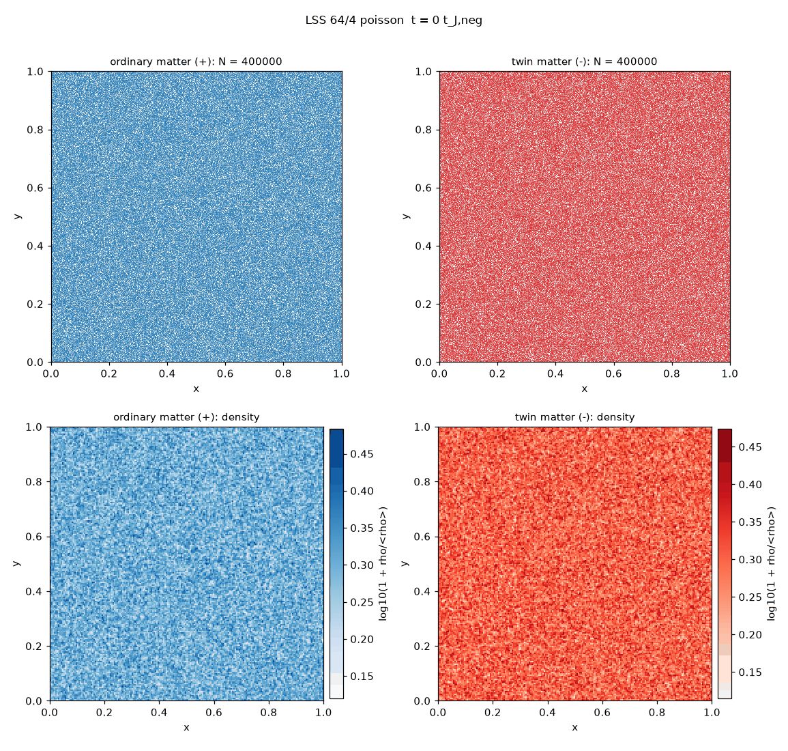
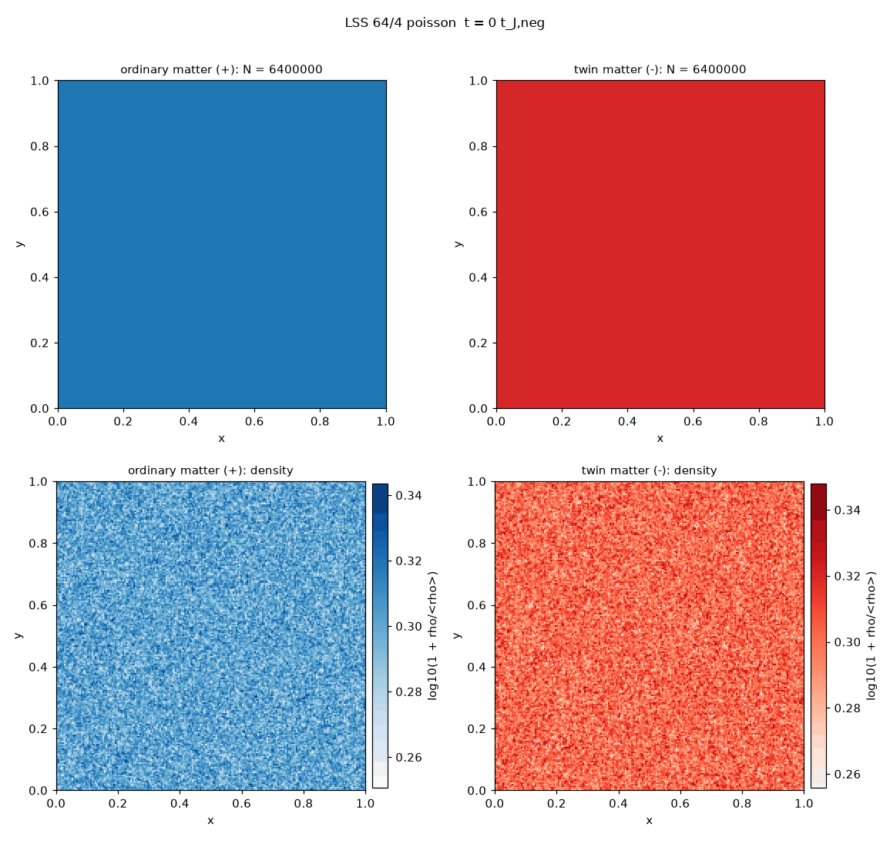

# Twin-matter N-body simulations: a reproduction and stress test

This repository reproduces, and then stress-tests, the 2-D N-body simulations of "twin matter" published by Jean-Pierre Petit and collaborators in the 1990s and early 2000s, in which a population of negative-mass particles interacts gravitationally with ordinary matter. The goal is neutral: find out how far the original results can be reproduced with modern numerical methods, and where they stop holding.

| Static box (original setup) | Expanding box, 8 Jeans lengths | Expanding box, 32 Jeans lengths, 60 Jeans times |
|---|---|---|
|  |  |  |

## Summary of findings

**Cells form, robustly.** With Petit's interaction laws and parameters, the heavy negative-mass population collapses into clumps, ordinary matter is pushed out into walls around them, and a cellular pattern appears within about 2 to 3 negative Jeans times. This held in every run: five seeds, two timesteps, four box sizes, with and without expansion, at up to 12.8 million particles.

**In a static box, as in the original simulations, the cells are transient.** The negative clumps keep merging until a single box-sized clump remains, in every seed and box size tested. Under the original assumptions, the simulations support "cells form" but not "cells are stable".

**With a cosmic expansion added (not part of the original setup), merging slows but does not stop.** A multi-cell network with negative clumps inside ordinary-matter voids survives to the end of every expanding run, reproducibly across seeds. In the largest box (32 Jeans lengths, 60 Jeans times), the clump count falls from a peak of 78 to 22, with the merging rate dropping from about 30% to about 10-20% per 10 Jeans times, but never reaching zero. An apparent plateau in a smaller box turned out to be the structure reaching box scale. The slowdown comes from the imposed expansion law, not from an equilibrium of the model.

**The large cells need twin matter.** Ordinary matter alone, under the same expansion, forms only fine-grained structure about a quarter of the size of the mixed run's cells.

All results are 2-D. The code also runs in 3-D and on the GPU; 3-D runs and the spiral-galaxy scenario are next.

## Background: the claims being tested

In the twin-matter (later "Janus") model, ordinary matter and twin matter of negative mass interact only through gravity, with three interaction laws: like masses attract, and positive and negative masses repel each other. The 2001 conference paper "Twin matter against dark matter" (Petit, Midy and Landsheat) describes 2-D simulations starting from uniform distributions of both populations, with the twin population 64 times denser and with a Jeans time eight times shorter, reporting a cellular large-scale structure with twin-matter clumps surrounded by ordinary matter, and a long-lived barred spiral galaxy confined by surrounding twin matter.

The specific claims tested here are that a cellular pattern forms, that the twin-matter clumps are stable, and that the structure is long-lived. The spiral-galaxy scenario is implemented in the code but has not yet been tested.

## Methodology

### Research pipeline

The project was carried out with a chain of AI-assisted steps, each written to a file in this repository so it can be inspected:

1. **Crawl** (`scriptscrape.py`): the author's website was crawled breadth-first and each page's text saved locally. The scraped content belongs to the site's author and is not included in this repository.
2. **Per-page analysis**: each page was summarized by Claude Haiku.
3. **Synthesis** (`synthesize.py`, output `final_report.md`): Claude Opus merged the summaries into a categorized report of the site.
4. **Investigation** (`investigate.py`, output `astrophysics_investigation.md`): Claude Fable carried out a neutral investigation of the computational astrophysics, focused on the twin-matter N-body simulations.
5. **Simulation design and code** (`build_sim.py`, outputs `simulation_notes.md` and `sim/`): Claude Fable designed the simulation from the investigation and the original pages, listing every assumption where the sources are vague, and wrote it as separate modules.
6. **GPU port** (`build_gpu.py` and `build_gpu_diag.py`, outputs `sim_gpu/` and `sim_gpu2/`): Claude Fable ported the forces, integrator and diagnostics to the GPU with PyTorch.
7. **Runs and validation**: simulations were run, tested and debugged as described below.
8. **Interpretation** (`sim/interpret_run.py`, outputs `interpretation.md` in each run folder): Claude Fable reviewed each key run's snapshots alongside its measured data.

All simulation code was AI-generated and should be read with that in mind. It was validated through the convergence, control and CPU-versus-GPU tests below rather than line-by-line review.

### Numerical model

- **Method**: particle-mesh (PM) gravity with FFT, in a periodic 2-D box of unit size, using the kernel -2πG/|k| (a razor-thin sheet with a 1/r² force law in the plane). A direct-summation O(N²) mode is available for cross-checks.
- **Interaction laws**: same-sign masses attract; opposite-sign masses repel. Equations of motion use |m| as inertial mass, so the |m|-weighted momentum is conserved while the signed momentum is not.
- **Integrator**: leapfrog kick-drift-kick, fixed timestep (default 0.02 negative Jeans times).
- **Mean density**: the k=0 mode is removed (the standard "Jeans swindle"), since the box has a net negative mass.
- **Initial conditions**: Poisson-uniform positions for both populations, Maxwellian velocities; shot noise seeds the instability.
- **Parameters from the original work**: twin-to-ordinary density ratio 64, velocity dispersion ratio 4.
- **Assumed**: absolute velocity scale set from the negative Jeans length relative to the box; softening equal to the PM cell size; run length 20 to 60 negative Jeans times.
- **Expansion (optional)**: comoving frame with a(t) ∝ t^(2/3) switched on at 1 Jeans time. This is a standard kinematic expansion law, not one derived from the Janus model.
- **Precision**: float64 on the CPU; float32 on the GPU, validated against float64.

All 17 assumptions (A1 to A17) are printed at the start of every run and saved as `assumptions.txt` in each output folder.

### Diagnostics and pre-registered criteria

Each run records energy and momentum conservation, clump counts and masses, a segregation index (anti-correlation of the two density fields), a persistence index (similarity of the pattern to a reference time), and the dominant structure scale. Three pass/fail criteria were fixed before any results: `cells_form`, `stable_clumps` and `persistence`. Some of these proved to be weak tests: segregation measured pixel by pixel weakens as walls thicken even when the populations remain visibly separate, and persistence measured against t = 5 penalizes any merging. The conclusions above therefore rely mainly on clump counts, structure scales and the images.

### Validation

The first runs had energy errors of several hundred percent, so no results were trusted until this was resolved:

| Test | Result | Conclusion |
|---|---|---|
| Timestep convergence (static) | Energy error fell only 2× per halving | Not a timestep problem |
| Positives alone | 0.5% error | Force solver and integrator are sound |
| Negatives alone | 134% error | Problem appears with the collapsing population |
| Positives alone, rescaled to match the negatives exactly | Identical energy log, digit for digit | No sign bug in the energy calculation |
| Negatives alone, 5k / 20k / 80k particles | 134% / 40% / 9.7% | Discreteness heating: error ∝ 1/N |
| Mixed, 800k particles, 64² grid | Energy within about ±1% | Trustworthy baseline |
| Baseline with half timestep | All metrics unchanged | Converged in timestep |
| Expansion run with half timestep | All metrics unchanged | Converged in timestep |

The key lesson is that the strongly unstable negative population needs about 200 particles per grid cell to avoid artificial heating. Runs with fewer particles produced misleading verdicts.

In expanding runs, E = KE + U is not conserved by design, so its large reported drift is expected; timestep convergence is used as the accuracy check instead.

### GPU port

The forces, integrator and diagnostics also run on an AMD Radeon RX 9060 XT via PyTorch with ROCm under WSL. In float64, GPU forces agree with the CPU to about 1e-15 and every diagnostic to about 1e-13; in float32, forces agree to about 1e-5. The GPU baseline reproduces the CPU baseline's metrics, verdicts and energy history, and runs in 35 s instead of 189 s; on large runs, forces are about 10 times faster.

## Results

### Static box (original setup)

| Run | Final negative clumps | Segregation | Notes |
|---|---|---|---|
| Baseline, 5 seeds | 1 in every seed | -0.64 to -0.76 | Cells at t ≈ 2-3, merge to one clump by t ≈ 7 |
| Half timestep | 1 | -0.69 | Identical to baseline |
| Box twice as large | 1 | -0.69 | Merging continues to box scale |
| Velocity ratio 1 | 1 | -0.74 | The positives' temperature hardly matters |

Timeline of the baseline run: the first 5 clumps appear at 2 Jeans times, peak at 8 clumps at 2.5, merge steadily to one clump by 5.5, and the final clump (about 40% of the negative mass, a quarter of the box across) is frozen from about 7 Jeans times onward.

### Expanding box, 8 Jeans lengths across

| Seed | 1 | 2 | 3 | 4 | 5 | Mean |
|---|---|---|---|---|---|---|
| Final clumps | 4 | 3 | 5 | 4 | 4 | 4.0 ± 0.6 |
| Clump loss, t = 5 to 20 | -64% | -57% | -67% | -64% | -67% | -64% ± 3% |

The same run with half the timestep gives identical metrics. Every seed keeps a multi-clump network where every static run ends with one clump.

### Long expanding runs (60 Jeans times)

| Time (Jeans times) | 10 | 20 | 30 | 40 | 50 | 60 |
|---|---|---|---|---|---|---|
| Clumps, 16 Jeans lengths | 29 | 14 | 12 | 8 | 7 | 7 |
| Clumps, 32 Jeans lengths | 78 | 50 | 35 | 31 | 25 | 22 |
| Dominant scale, 32 Jeans lengths (fraction of box) | 0.14-0.2 | 0.2 | 0.2-0.25 | 0.2-0.25 | 0.25-0.33 | 0.33 |

Up to about 30 Jeans times, clump density per unit area agrees between the two boxes to within about 10%, so this phase is not a box effect. Afterwards they diverge: the smaller box stops at 7 clumps because its structure reaches box scale, while in the larger box merging continues, slowing from about 30% to about 10-20% per 10 Jeans times. In the 16-length box without expansion, everything merges into one clump within 20 Jeans times.

### Positives-only control (32 Jeans lengths, expansion, 60 Jeans times)

Ordinary matter alone forms only fine-grained structure, with a dominant scale of 0.08 of the box at the end, against 0.25-0.33 in the mixed run, and a nearly frozen pattern. The large cells, and their evolution, require twin matter; ordinary matter's own gravity plausibly contributes the small knots within the walls.

### In progress

A 64-Jeans-length box with expansion (51 million particles, GPU) to follow coarsening without reaching the box scale; the spiral-galaxy scenario; and 3-D runs.

## What this says about the original claims

The mechanism Petit described is reproducible and robust: twin matter clumps, ordinary matter is confined to walls, and a cellular pattern forms quickly. The stability he reported is not reproduced under his assumptions: in a static box, the cells merge until one clump remains. With an added expansion law, merging slows strongly but continues. The simulations do not test the claims about dark matter, galaxy rotation or the observed cosmic web.

## Limitations

- 2-D only so far; the original work was also 2-D, but real structure formation is 3-D.
- The absolute velocity scale, softening and run length are not given in the original sources and were assumed.
- The expansion law is a generic kinematic one, not derived from the Janus model, and expansion was not part of the original simulations.
- Some diagnostics have known weaknesses (see above).
- No quantitative comparison with observations has been made.

## Reproducing

Requirements: Python 3.12, numpy, scipy, matplotlib (and anthropic for the AI pipeline scripts, with `ANTHROPIC_API_KEY` set in the environment). The GPU version additionally needs ROCm and AMD's ROCm build of PyTorch (tested with ROCm 7.2 and PyTorch 2.9.1 under WSL on Ubuntu 24.04).

```bash
python -m venv venv && source venv/bin/activate
pip install numpy scipy matplotlib anthropic
cd sim
python main.py --help
python main.py assumptions lss

# Trustworthy static baseline (about 3 minutes on the CPU)
python main.py lss --grid 64 --npos 400000 --nneg 400000

# Seed ensemble
python main.py ensemble lss --seeds 5 --grid 64 --npos 400000 --nneg 400000

# Expansion, 32 Jeans lengths, 60 Jeans times
python main.py lss --grid 256 --npos 6400000 --nneg 6400000 --lambda-j-neg 0.03125 --expansion --tmax 60

# Fable's review of a run, and movies
python interpret_run.py out/<run_folder>
./make_movies.sh
```

GPU version, from `sim_gpu2/`:

```bash
python main.py gputest    # GPU vs CPU forces
python main.py diagtest   # GPU vs CPU diagnostics
python main.py lss --device gpu --grid 64 --npos 400000 --nneg 400000
```

## Repository layout

- `scriptscrape.py`, `synthesize.py`, `investigate.py`, `build_sim.py`: AI research pipeline
- `build_gpu.py`, `build_gpu_diag.py`, `export_prompt.py`: GPU port pipeline
- `final_report.md`, `astrophysics_investigation.md`, `simulation_notes.md`, `gpu_plan.md`, `gpu_diag_plan.md`: pipeline outputs
- `sim/`: CPU simulation (the validated reference), helper scripts, and run outputs in `sim/out/`
- `sim_gpu/`: first GPU version (forces and integrator)
- `sim_gpu2/`: current GPU version (forces, integrator and diagnostics)
- `media/`: animations shown above

## References

1. Petit, J.-P. (1994). "The missing-mass problem". *Il Nuovo Cimento B*.
2. Petit, J.-P., Midy, P., Landsheat, F. (2001). "Twin matter against dark matter". Marseille Cosmology Conference *Where's the Matter? Tracing Dark and Bright Matter with the New Generation of Large Scale Surveys*, Marseille, France. https://januscosmologicalmodel.com/pdf/2001-where-is-the-matter.pdf
3. Petit, J.-P., d'Agostini, G. (2014). "Negative mass hypothesis in cosmology and the nature of dark energy". *Modern Physics Letters A* 29, 1450182.
4. Janus Cosmological Model reference list: https://januscosmologicalmodel.com/map
5. Author's website (source of the crawled pages): http://www.jp-petit.org
6. Bondi, H. (1957). "Negative mass in general relativity". *Reviews of Modern Physics* 29, 423.
7. Hockney, R. W., Eastwood, J. W. (1988). *Computer Simulation Using Particles*. Taylor & Francis. (Particle-mesh methods.)
8. Binney, J., Tremaine, S. (2008). *Galactic Dynamics*, 2nd ed. Princeton University Press. (Jeans instability, Jeans swindle, collisionless dynamics.)
